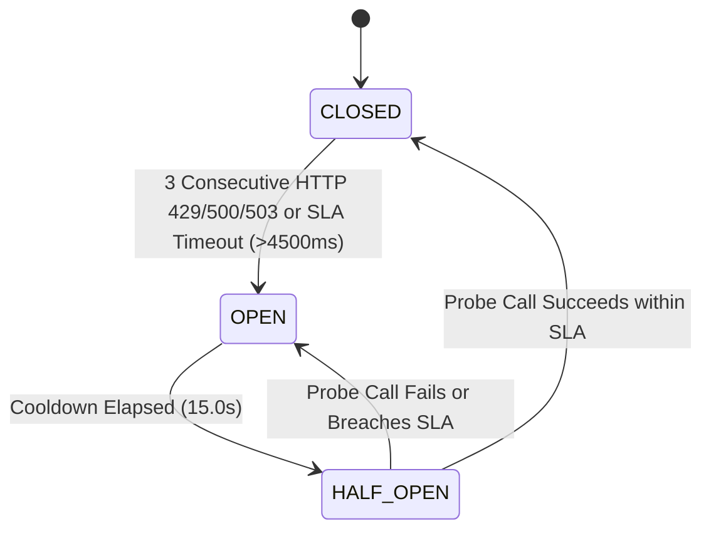

# AETHER Engine — C4 Architecture & Protocol Specifications

## 1. System Context & Hexagonal Topology

**AETHER Engine** (*Autonomous Event-driven Task & Hybrid Evaluation Runtime*) is designed as a strict **Clean / Hexagonal Architecture** monorepo separating deterministic domain state machines from external I/O adapters.

```mermaid
flowchart TD
    subgraph Client_Tier["Client & Edge Tier"]
        CLI["SDK / Enterprise Client"]
        WS["SSE / WebSocket Stream Consumer"]
    end

    subgraph Control_Plane["AETHER FastAPI Control Plane (server/)"]
        API["REST & WebSocket Ingress"]
        GR["Streaming Guardrail Interceptor\n(256-char Rolling Buffer)"]
        OTEL["AetherTracer (W3C TraceContext)"]
    end

    subgraph Core_Domain["AETHER Core Engine (packages/aether-core)"]
        DAG["StatefulDAG Runner\n(Kahn's Topological Sort)"]
        CB["SmartGateway & Circuit Breaker\n(Full Exponential Jitter)"]
        MEM["HybridSemanticMemory\n(L1 Token Window + L2 Vector)"]
    end

    subgraph Persistence_And_Models["Persistence & Multi-Provider Model Mesh"]
        PG[("PostgreSQL 16 + pgvector\n(ACID Event Journal & HNSW)")]
        REDIS[("Redis 7.2 Cluster\n(Pub/Sub & Ephemeral Ring)")]
        LLM1["Gemini 2.0 Pro (Primary)"]
        LLM2["Claude 3.5 Sonnet (Failover #1)"]
        LLM3["GPT-4o (Failover #2)"]
        VLLM["Local vLLM Llama-3.1-70B"]
        JAEGER["Jaeger / Langfuse OTLP"]
    end

    CLI -->|POST /v1/dag/execute| API
    WS <-->|WSS /v1/gateway/ws| API
    API --> GR
    GR --> DAG
    GR --> CB
    DAG --> MEM
    DAG -->|Append SHA-256 Event| PG
    MEM <-->|L1 Sliding Window| REDIS
    MEM <-->|L2 Cosine HNSW| PG
    CB -->|1. Primary SLA <4.5s| LLM1
    CB -.->|2. Trip on 3x 429/503 (<150ms)| LLM2
    CB -.->|3. Secondary Failover| LLM3
    CB -.->|4. Air-gapped Fallback| VLLM
    API --> OTEL
    OTEL -->|gRPC :4317| JAEGER
```

---

## 2. Deterministic Circuit Breaker Protocol

Each model provider in `SmartGateway` is wrapped by an isolated `CircuitBreaker` state machine:



- **Full Exponential Jitter Backoff**:
  $$\text{sleep\_ms} = \mathcal{U}\left(0, \min\left(\text{cap}, \text{base} \times 2^{\text{attempt}}\right)\right)$$
- **Context Cancellation Propagation**: When a client closes an SSE/WebSocket connection (`cancel_event.is_set()`), `SmartGateway.stream()` invokes `await stream_iter.aclose()` on the underlying provider generator within the same event-loop tick, immediately halting remote/local GPU token generation.

---

## 3. Event-Sourced Transactional DAG Protocol

Every node transition writes an immutable `ExecutionEvent` sealed with a SHA-256 integrity digest:

| Field | Type | Description |
| :--- | :--- | :--- |
| `run_id` | `UUID / str` | Unique correlation identifier for the workflow execution |
| `node_id` | `str` | Vertex identifier in the topologically sorted DAG |
| `status` | `NodeStatus` | `PENDING`, `RUNNING`, `COMPLETED`, `FAILED`, `SKIPPED` |
| `step_index` | `int` | Deterministic topological index ($1 \dots N$) |
| `state_delta` | `JSONB` | Pure state output produced by the node handler |
| `cost_usd` | `float` | Exact financial expenditure incurred at this vertex |
| `event_hash` | `char(64)` | Canonical SHA-256 over `(run_id, node_id, status, step_index, state_delta, cost_usd)` |

When a worker crashes at Step 4, the replacement worker queries `get_completed_nodes(run_id)`, reconstructs the state dictionary from Steps $1 \dots 3$ in sub-millisecond time, and executes Step 4 with zero duplicate LLM calls.
